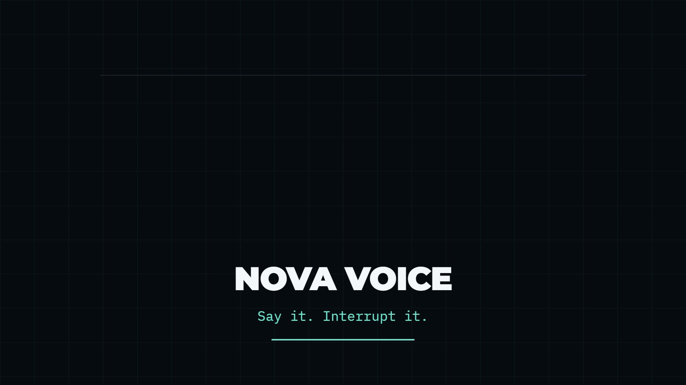

# Nova Voice

A hands-free voice assistant: wake word → speech-to-text → LLM (Claude or a local
Ollama model, with tool use) → streaming text-to-speech. The engineering focus is
**perceived latency** and **natural turn-taking**: the assistant starts speaking
before its answer has finished generating, and you can interrupt it mid-sentence.

# Nova Voice

**[Live demo and landing page](https://urjanandy23.github.io/Nova_Voice/)** · [Watch the 25-second video](https://github.com/urjanandy23/Nova_Voice/raw/main/docs/brag.mp4)

[](https://urjanandy23.github.io/Nova_Voice/)

> **Status of the numbers.** Every performance figure in this README comes from a
> script in this repo that you can re-run. Sections marked **TODO: run** are not
> measured yet; they are filled in by the commands shown, never by hand.

## How it works

```
 mic ─▶ wake word ─▶ record (adaptive endpointing) ─▶ Whisper ─▶ LLM stream ─▶ chunker ─▶ TTS synth ─▶ speaker
        (openwakeword)  noise-calibrated threshold    (local)    + tool loop   sentence/    (edge-tts)   (interruptible
                                                                                clause                    OutputStream)
                              ▲                                                                              │
                              └────────────── barge-in monitor: sustained speech while talking ─────────────┘
```

**Streaming pipeline.** `src/text_utils.py` cuts the token stream into speakable
chunks the moment they complete; `src/tts.py` synthesizes chunk 2 while chunk 1 is
playing. Chunking is abbreviation-aware (`Dr.`, `U.S.`, `e.g.`, `3.5`, `1.` list
markers do not end a sentence) and can optionally cut the *first* chunk at a comma
once it is `FIRST_CHUNK_MIN_CHARS` long, to start speaking sooner on long opening
sentences.

**Turn-taking and voice quality**

| Feature | What it does | File |
|---|---|---|
| Adaptive endpointing | Speech threshold = 3× the room's measured noise (never below a floor), re-measured every recording, instead of a fixed magic number | `src/vad.py`, `src/stt.py` |
| Min-speech gate | A click or cough no longer starts a recording | `src/vad.py` |
| Shorter end-of-speech wait | 0.8 s of trailing silence (was 1.2 s). That wait is added to *every* turn. Trailing silence is trimmed before Whisper | `src/config.py`, `src/stt.py` |
| Interruptible playback | Audio goes out through a `sounddevice` stream in ~64 ms blocks, so `stop()` silences the voice almost instantly. The old blocking player could not be stopped | `src/tts.py` |
| Barge-in (`--barge-in`) | Speaking over the assistant stops its voice, cancels generation, and the words already heard are prepended to the next recording so they are not lost | `src/barge_in.py` |
| Ctrl+C interrupt | Stops the current reply without exiting (any mode) | `src/assistant.py` |
| Speech cleaning | Markdown, URLs and list markers are removed before synthesis so they are not read aloud | `src/text_utils.py` |
| Fault isolation | One failed TTS sentence, tool crash, or API error no longer stalls or kills the turn; history is rolled back so the next turn is valid | `src/tts.py`, `src/assistant.py`, `src/functions.py` |
| Mic / STT recovery | A missing or unplugged mic, a Whisper failure or a wake-word model error abandons that turn with a clear message and retries. After 3 failures in a row the assistant degrades instead of crashing: broken wake-word model → push-to-talk, broken mic or audio libraries → text-only. Model-load failures (e.g. first run offline) exit with an actionable message | `src/errors.py`, `src/stt.py`, `src/wake_word.py`, `src/assistant.py` |
| Per-stage timing | Each reply prints a `[timing]` line: `wake_to_listen` (wake word → mic live), `endpoint_wait` (the silence wait that ends your turn), `stt`, `llm_first_token`, `tts_first_audio`, `perceived` (you stop talking → you hear a reply, silence wait included) and `total`, plus wake-word inference time per 80 ms frame vs its budget | `src/metrics.py`, `src/stt.py`, `src/wake_word.py` |

**Tools** (`src/functions.py`): `set_reminder`, `list_reminders`, `cancel_reminder`,
`search_web`. Reminders use timezone-aware timestamps, atomic file writes, and fire
within ~1 s; the speaking callback runs outside the file lock. Tool arguments are
validated and errors are returned to the model as text instead of raising. Web results
are truncated, cached briefly, and labelled as untrusted text in the prompt (a basic
prompt-injection mitigation, not a guarantee).

**Memory** (`src/memory.py`): a rolling window that trims only at user-turn
boundaries, so a `tool_use` message is never separated from its `tool_result`
(which the Anthropic API rejects). `ConversationMemory` holds only what backends
share; `AnthropicMemory` and `OllamaMemory` add each provider's own message format.

**LLM backends** (`src/llm_base.py`): chunking, cancellation, the tool-round limit and
tool dispatch live once in `BaseVoiceLLM`. `llm.py` (Claude) and `llm_ollama.py` only
implement "run one streamed round" and "write it into my memory format".

## Project structure

```
├── main.py                     # CLI entry point
├── src/
│   ├── config.py               # env vars & tunables
│   ├── prompts.py              # system prompt (tool-use rules)
│   ├── text_utils.py           # sentence/clause chunking, speech cleaning  (pure, tested)
│   ├── vad.py                  # endpointing + barge-in state machines      (pure, tested)
│   ├── metrics.py              # per-turn Timeline, percentiles             (pure, tested)
│   ├── memory.py               # turn-safe window; Anthropic / Ollama formats    (pure, tested)
│   ├── errors.py               # MicrophoneError, TranscriptionError
│   ├── llm_base.py             # shared streaming + tool loop                    (pure, tested)
│   ├── functions.py            # tools: reminders, web search
│   ├── llm.py / llm_ollama.py  # Claude / Ollama: one streamed round each
│   ├── stt.py                  # recording + faster-whisper
│   ├── tts.py                  # edge-tts pipeline + interruptible playback
│   ├── wake_word.py            # openwakeword listener
│   ├── barge_in.py             # mic monitor while the assistant talks
│   └── assistant.py            # orchestration
├── tests/                      # 125 unit tests; fake mic/Whisper/TTS/LLM (tests/_stubs.py)
├── benchmarks/latency_benchmark.py
├── evals/
│   ├── cases.py                # single-turn + multi-turn eval cases
│   └── tool_calling_eval.py
└── .github/workflows/ci.yml
```

## Setup

1. `python3 -m venv venv && source venv/bin/activate` (Windows: `venv\Scripts\activate`)
2. System audio deps: macOS `brew install portaudio ffmpeg` · Ubuntu `sudo apt install portaudio19-dev ffmpeg` · Windows: install [ffmpeg](https://ffmpeg.org/download.html) and add it to PATH.
3. `pip install -r requirements.txt`
4. `cp .env.example .env` and set `ANTHROPIC_API_KEY`, **or** set `LLM_PROVIDER=ollama` to use a free local model (`ollama pull llama3.2`).
5. First run downloads the Whisper model (~150 MB for `base`) and the wake-word model.

### Reproducible installs

`requirements.txt` uses bounded ranges (lower bound = what the code was written against, upper bound = next major version). For exact pins, create a lock file from an environment where everything installed and the app ran once:

```bash
pip freeze > requirements.lock     # commit it if you want others to reproduce your versions
pip install -r requirements.lock   # on another machine
```

Python 3.13 removed `audioop`, which `pydub` needs; `requirements.txt` pulls in `audioop-lts` there automatically.

## Running

```bash
python main.py                    # hands-free: say "hey jarvis"
python main.py --push-to-talk     # press Enter, then speak
python main.py --hybrid           # each turn: speak or type
python main.py --text-only        # no mic; reply is still spoken
python main.py --barge-in         # add to any voice mode: interrupt by speaking
```

**Barge-in caveat:** there is no acoustic echo cancellation. With loudspeakers the
assistant's own voice can leak into the mic and interrupt itself, so use headphones,
or raise `BARGE_IN_RMS`. That is why it is opt-in.

## Configuration

See `.env.example`. The tunables that matter most for feel:

| Variable | Default | Effect |
|---|---|---|
| `SILENCE_DURATION` | 0.8 | Seconds of silence that end your turn. Lower = snappier but may cut you off mid-pause |
| `MIN_SPEECH_RMS` / `NOISE_MULTIPLIER` | 300 / 3.0 | Floor and multiplier for the adaptive speech threshold |
| `FIRST_CHUNK_MIN_CHARS` | 40 | Cut the first spoken chunk at a comma after this many chars (0 = whole sentences only) |
| `WHISPER_MODEL_SIZE` | base | Bigger = more accurate, slower |
| `BARGE_IN_RMS` / `BARGE_IN_SUSTAIN_SECONDS` | 1500 / 0.4 | What counts as an interruption |

## Tests

```bash
python -m unittest discover -s tests -v
```

125 tests, no microphone, speakers, API key or network needed. Audio, model and LLM
libraries are replaced by fakes in `tests/_stubs.py`. Covered: sentence/clause chunking,
endpointing and barge-in logic, memory trimming (both formats), reminders and
tool-argument validation, the shared streaming/tool/cancel loop through **both** the
Claude and Ollama backends, STT recording and transcription (including mic-lost and
Whisper-failure paths and the end-of-speech timing), wake-word loop (threshold, per-frame
timing, device and model errors), the TTS worker (ordering, failed sentence, interruption),
the assistant loop (turn flow, rollback, failure counting, fallback to a working mode)
and the eval case sets.

Not covered, because it needs real hardware or services: that the actual microphone,
speakers, Whisper, openwakeword, edge-tts and live LLMs behave as the fakes assume.

## Measured results

Re-run these on your own machine; both scripts write their output into the repo.

### 1. Latency: does streaming help, and where does time go?

```bash
python benchmarks/latency_benchmark.py --repeats 3 --with-tts
```

It reports median / p95 over repeated runs for two prompt sets: **short** (one-sentence
answers, where streaming cannot help) and **long** (multi-sentence answers, where it
should), comparing naive (wait for full reply) vs sentence streaming vs clause-cut
streaming, plus real edge-tts synthesis time. It records provider, model, hardware, and
how many runs involved a tool call.

**TODO: run** → paste `benchmarks/results_<provider>.md` here (one file per provider).

**Earlier run, kept for honesty** (`benchmarks/archive/`): a single run over 10
one-sentence prompts on a local Ollama model gave an average time-to-first-audio of
28.8 s with streaming vs 29.6 s naive (3 % faster; 7 of 10 prompts showed no change).
Two lessons: (a) one-sentence answers cannot benefit from sentence streaming, so the
benchmark now includes multi-sentence prompts; (b) ~29 s is far above normal LLM
latency, and the tool-calling eval below shows a likely cause: the model was calling
`search_web` on trivia, adding a search round trip to every turn. The benchmark now
reports tool-involved runs separately so this cannot hide.

### 2. Tool-calling accuracy

```bash
python evals/tool_calling_eval.py --repeats 3          # both suites
python evals/tool_calling_eval.py --suite multi        # only the multi-turn cases
```

Two suites (`evals/cases.py`):

- **single** (28 cases): set / list / cancel reminder, web search, no-tool general
  knowledge, and ambiguous requests (no time given → should ask, not guess).
- **multi** (19 cases): scripted history, including earlier tool calls and their results
  rendered in each provider's real message format, then a follow-up: supplying the missing
  time ("in 20 minutes"), "cancel that", "make it 30 minutes" (cancel first), "and in
  Paris?", "what's the weather there?", and cases where the right answer is *no* tool even
  though tools were used earlier ("thanks", "summarize that", a topic switch).

The label is the first tool the model should call for the last message. Reports overall
and per-suite accuracy, per-tool precision/recall, a confusion matrix and every failure,
tagged with a hash of the prompt and tool descriptions. Output goes to
`evals/results_<provider>.md`, so a Claude run never overwrites an Ollama run.

**Before** (`evals/archive/`, old prompt, `llama3.2` via Ollama, 13 cases): **9/13
(69.2 %)**. All 4 failures were the same bug: `search_web` called for trivia ("capital of
France", "boiling point of water", ...).

**After** (rewritten system prompt and tool descriptions with explicit "do not search for
general knowledge" rules, plus a larger case set): **TODO: run** → paste
`evals/results_ollama.md` and, for Claude, `evals/results_anthropic.md`. Not directly comparable with *before* (different, larger case
set); to compare fairly, run both prompts on the same cases.

## Privacy

What stays on your machine and what leaves it. This project adds no analytics or
telemetry of its own.

| Data | Where it goes | Kept? |
|---|---|---|
| **Microphone audio** | Wake-word detection and Whisper both run **locally**. In `--text-only` mode the mic is never opened. | In RAM only, for the current utterance (plus a 1 s rolling buffer while `--barge-in` is on). Never written to disk. |
| **Your transcribed words** | Sent to the LLM you chose, together with the last `MAX_HISTORY_TURNS` (12) turns, the system prompt and tool results. **Claude:** Anthropic's API. **Ollama:** `OLLAMA_HOST` (default `localhost`, so nothing leaves the machine; if you point it at another host, the text goes there). | Conversation history lives in RAM and is gone when you quit. How long a provider retains API data is governed by that provider's own terms. |
| **Assistant replies** | Sent as text to Microsoft's online voice service through `edge-tts` for synthesis, so replies and reminder text leave your machine even with Ollama. | Not stored by this project. |
| **Web searches** | The `search_web` tool sends the model-written query to DuckDuckGo (via `ddgs`). The snippets that come back are passed to the LLM. The model may put details from your request into the query. | Cached in RAM for `SEARCH_CACHE_SECONDS` (300). |
| **Reminders** | Local file `reminders.json` in the working directory (plain text: text and time). Fired reminders stay in the file marked as fired. | Until you delete the file. It is in `.gitignore`. |
| **Terminal output** | Your transcript, the reply and the timing line are printed. Errors are logged to stderr (tracebacks, never audio). | Whatever your terminal scrollback keeps. |
| **Model downloads** | First run downloads the Whisper and wake-word models from their upstream hosts. | Cached locally by those libraries. |

Practical notes:

- In wake-word mode the mic is always open, but audio is only scored locally. Nothing is
  transcribed or sent anywhere until the wake word fires, so a **false wake** will record
  and send whatever was said next. Raise `WAKE_WORD_THRESHOLD` if that happens. Anyone
  within earshot of the mic is captured, so tell the people around you.
- To keep the LLM local use `LLM_PROVIDER=ollama`. That does **not** make the assistant
  offline: speech output (`edge-tts`) and `search_web` still use the network. There is no
  switch to disable them yet; removing the `search_web` entry from `TOOLS` in
  `src/functions.py` turns search off, and `tts.py` is the one file to change for an
  offline voice.
- The system prompt tells the model to treat search results as untrusted data. That is a
  mitigation, not a guarantee: a web page can still try to steer the model.
- To erase local state: delete `reminders.json` and stop the program (history is only in RAM).
- The evals and the benchmark send only their scripted prompts, never microphone data.

## First-run checklist

**Before the first run** (already done in this repo): `python -m unittest discover -s tests`
should pass anywhere, with no hardware.

**Needs a real run** (record the output, then paste it into the sections above):

1. `python main.py --push-to-talk`: confirm the mic, Whisper, the LLM and TTS work together,
   and read the `[timing]` line: `endpoint_wait` should be ≈ `SILENCE_DURATION`;
   `wake_to_listen` should be small (speech inside this gap is not recorded).
2. `python main.py`: say the wake word 10+ times and leave it idle for a few minutes
   to see false wakes; check `wake_infer_max` stays under the 80 ms budget.
3. Pull the mic (or revoke permission) mid-session and confirm you get a message, not a crash.
4. `python evals/tool_calling_eval.py --repeats 3` with `LLM_PROVIDER=ollama`, then with
   `LLM_PROVIDER=anthropic`.
5. `python benchmarks/latency_benchmark.py --repeats 3 --with-tts` for both providers.
6. `pip freeze > requirements.lock` once everything works.
7. Optional: `pip install mypy && mypy src` to check the new type hints.

## Known limitations

- **No echo cancellation**, so barge-in depends on headphones or a tuned threshold.
- **Energy-based endpointing**, not a neural VAD. It adapts to room noise but can still
  misfire with loud background speech or music. (Whisper's own VAD filter runs afterwards.)
- **edge-tts is a network service**, so the first-audio time includes a network round trip
  and depends on connectivity. Offline TTS would be a straightforward swap in `tts.py`.
- **Sentence splitting is heuristic.** Abbreviation handling is a fixed list, not NLP.
- **Reminders live in a local JSON file** polled once a second; they survive restarts but
  not a second machine, and the app must be running for them to be spoken.
- **Web search** is DuckDuckGo snippets with no source verification.
- **Not yet measured:** end-to-end latency on real hardware (the `[timing]` line now reports
  the endpoint wait and wake-word stages, but nobody has collected numbers yet), word error
  rate for Whisper in your environment, false-wake / false-barge-in rates, and any figure
  for the Claude path.
- **Type hints** cover every module in `src/`, but `mypy` has not been run on them.

## Extending

- **Better voices:** replace `StreamingTTS._synthesize`; the queue + interruptible playback do not change.
- **New tool:** add a schema to `TOOLS`, an implementation, and a branch in `dispatch_tool`; add cases to `evals/`.
- **Swap STT / LLM:** `stt.py` and `llm.py` / `llm_ollama.py` are the only files that touch Whisper / the LLM.

## License

MIT
